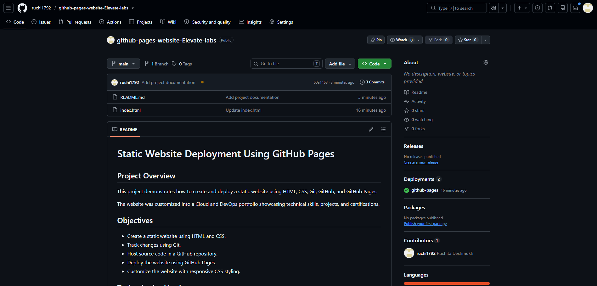
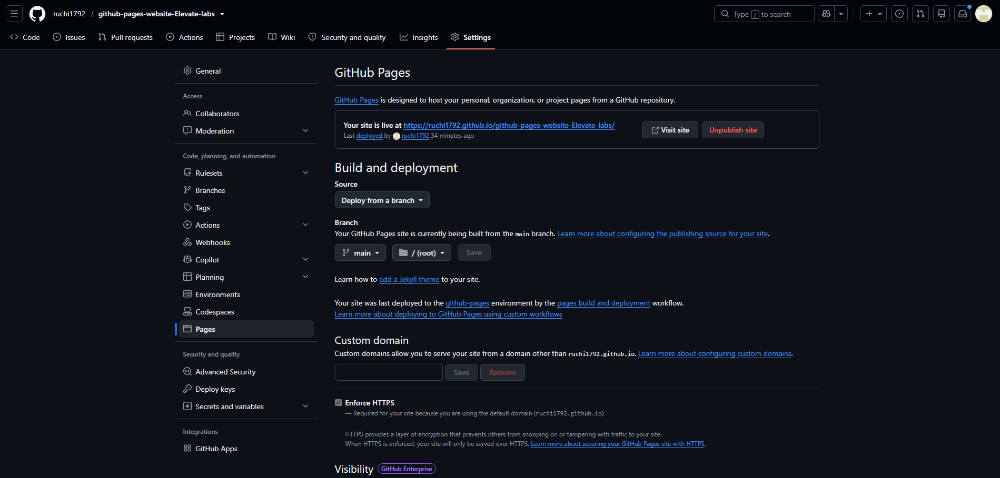
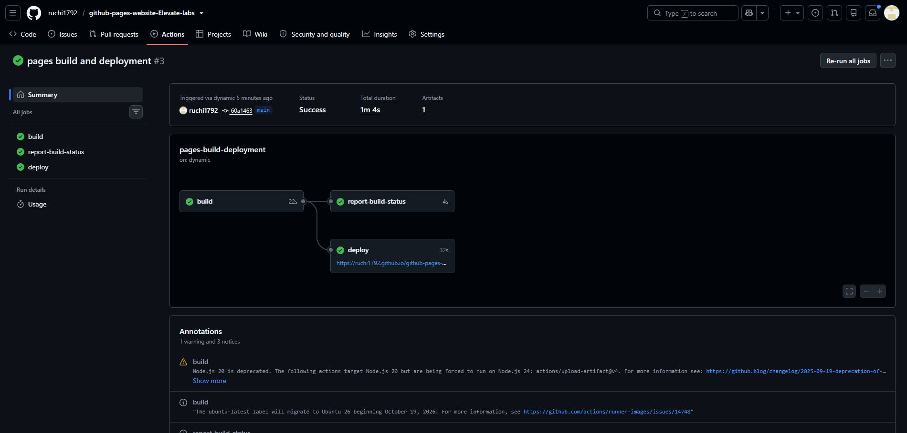
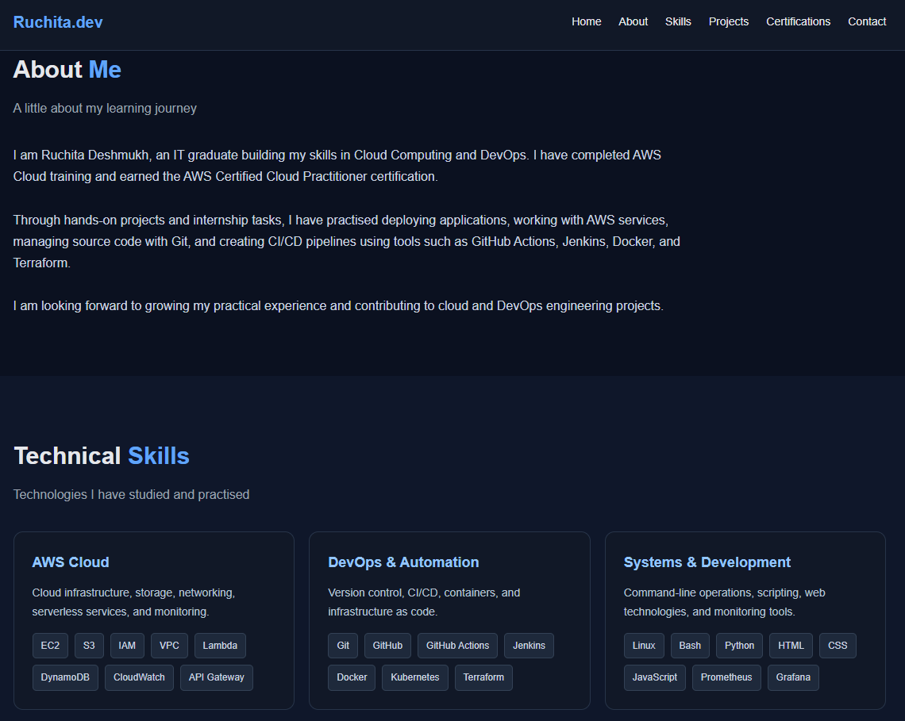
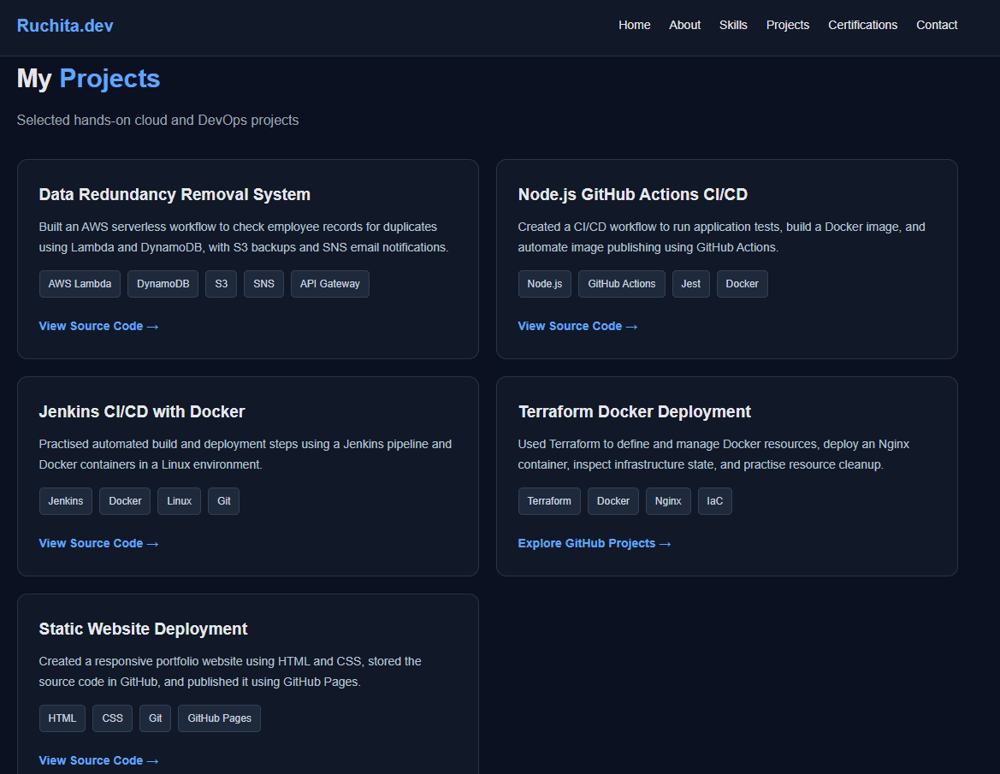
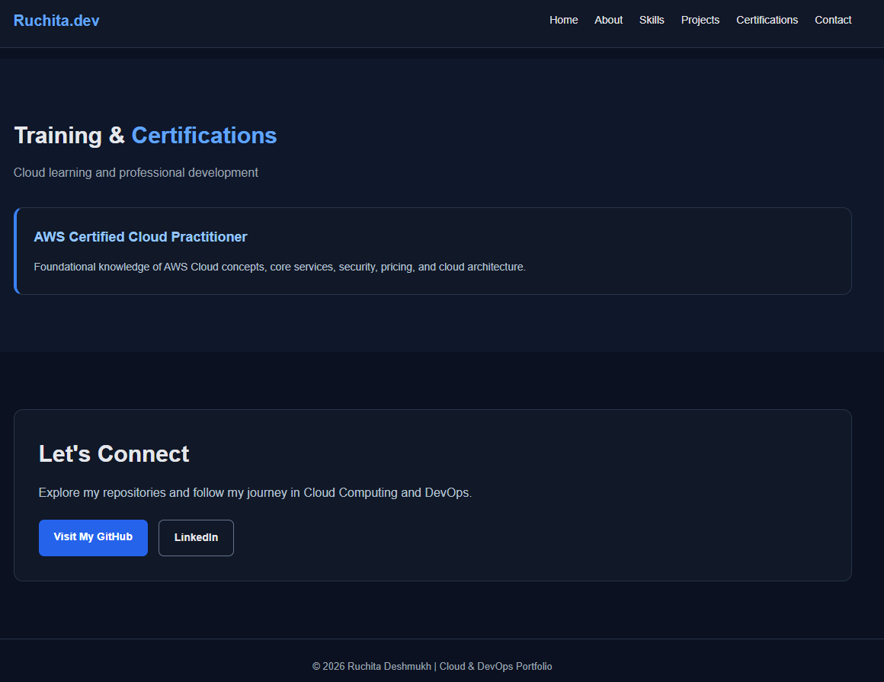

# 🚀 Static Website Deployment Using GitHub Pages

🌐 **Live Website:** [Visit My Portfolio](https://ruchi1792.github.io/github-pages-website-Elevate-labs/)

🐙 **GitHub Repository:** [View Source Code](https://github.com/ruchi1792/github-pages-website-Elevate-labs)

---

## 📌 Project Overview

This project demonstrates how to create, customize, and deploy a static website using **HTML, CSS, Git, GitHub, and GitHub Pages**.

The original website was enhanced into a professional Cloud & DevOps portfolio featuring an introduction, technical skills, projects, certifications, and useful GitHub links.

The website is hosted using GitHub Pages and is publicly accessible through its live URL.

## 🎯 Project Objectives

- 🌐 Create a static website using HTML5.
- 🎨 Customize the website using CSS3.
- 🔧 Manage source code with Git.
- 🐙 Store and maintain the project in GitHub.
- 🚀 Deploy the website using GitHub Pages.
- 📱 Apply responsive styling for different screen sizes.
- 📸 Capture screenshots to document the implementation.
- 📘 Document the project using Markdown.

## 🛠️ Technologies Used

| Technology | Purpose |
|---|---|
| 🌐 HTML5 | Structures the website content |
| 🎨 CSS3 | Provides styling, layout, and responsiveness |
| 🔧 Git | Tracks source code changes |
| 🐙 GitHub | Hosts the repository |
| 🚀 GitHub Pages | Publishes the static website |
| 🐧 WSL Ubuntu | Local development environment |
| 📝 Markdown | Project documentation |

## 🏗️ Project Architecture

```text
          👩‍💻 Developer
                |
                v
        🐧 WSL Ubuntu
                |
                v
         🌐 HTML + CSS
                |
                v
           🔧 Git Commit
                |
                v
          🐙 GitHub Repo
                |
                v
       🚀 GitHub Pages Build
                |
                v
        🌍 Published Website
                |
                v
        👥 Website Visitors
```

## ⚙️ Implementation Steps

### 1️⃣ Create the Website

Created an `index.html` file containing the website structure and CSS styling.

### 2️⃣ Set Up Git

Used Git to track changes and manage the website source code locally.

### 3️⃣ Create a GitHub Repository

Created a repository to store the website files and maintain version history.

### 4️⃣ Push the Source Code

Uploaded the HTML and CSS website code to the `main` branch.

### 5️⃣ Configure GitHub Pages

Opened **Settings → Pages** and configured the publishing source:

- **Source:** Deploy from a branch
- **Branch:** `main`
- **Folder:** `/ (root)`

### 6️⃣ Publish the Website

GitHub Pages built and published the website using the repository's source files.

### 7️⃣ Customize the Website

Enhanced the original design into a Cloud & DevOps portfolio with navigation, skills, projects, certifications, and GitHub links.

### 8️⃣ Verify Deployment

Opened the live website in a browser and checked that the updated portfolio was displayed correctly.

### 9️⃣ Document the Project

Created this README file and added screenshots as project evidence.

## ✨ Website Features

- 👋 Personal introduction
- ☁️ Cloud & DevOps portfolio
- 🧰 Technical skills section
- 💼 Project showcase
- 🏅 Certifications section
- 🔗 GitHub profile and project links
- 📱 Responsive CSS layout
- 🎨 Professional dark theme with blue accents
- 🔒 HTTPS-enabled website

## 📸 Project Screenshots

The following screenshots are stored in the `Screenshots/` directory.

### 1️⃣ GitHub Repository

Shows the project repository and source code files.



### 2️⃣ GitHub Pages Settings

Shows the GitHub Pages publishing configuration.



### 3️⃣ Successful Deployment

Shows evidence of the GitHub Pages deployment workflow.



### 4️⃣ Live Website Homepage

Shows the deployed Cloud & DevOps portfolio homepage.


### 5️⃣ Portfolio Screenshot



### 6️⃣ Portfolio Screenshot



### 7️⃣ Portfolio Screenshot



> 📌 All screenshot paths use the exact filenames and uppercase `.PNG` extensions present in the project directory.

## 🧠 Key Learnings

- 📄 Understanding HTML and CSS fundamentals.
- 🎨 Customizing a website with CSS.
- 🔀 Tracking and managing changes with Git.
- 🐙 Working with GitHub repositories and branches.
- 🚀 Configuring GitHub Pages for static website hosting.
- 🔍 Verifying deployments and troubleshooting publishing issues.
- 📱 Creating a responsive website layout.
- 📘 Writing technical documentation using Markdown.

## 🔍 Verification

The following checks were used during the project:

- ✅ Website source code committed to Git.
- ✅ Source code uploaded to GitHub.
- ✅ GitHub Pages configured to publish from `main` and `/ (root)`.
- ✅ Updated portfolio verified in the browser.
- ✅ README and screenshot documentation prepared.

## 🎓 Project Outcome

Successfully deployed a customized static portfolio website using GitHub Pages.

This project provided practical experience with **HTML, CSS, Git version control, GitHub repository management, static website hosting, and deployment verification**.

## 🔗 Project Links

- 🌐 **Live Website:** https://ruchi1792.github.io/github-pages-website-Elevate-labs/
- 🐙 **GitHub Repository:** https://github.com/ruchi1792/github-pages-website-Elevate-labs

## 👩‍💻 Author

**Ruchita Deshmukh**

☁️ Cloud Computing | 🚀 DevOps | 🐧 Linux

🔗 [GitHub Profile](https://github.com/ruchi1792)

---

⭐ Thank you for visiting my project!

